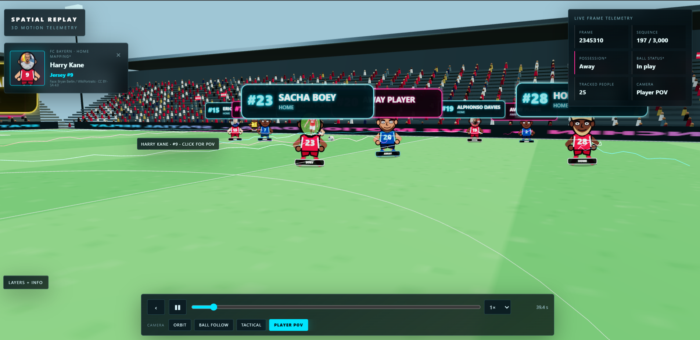
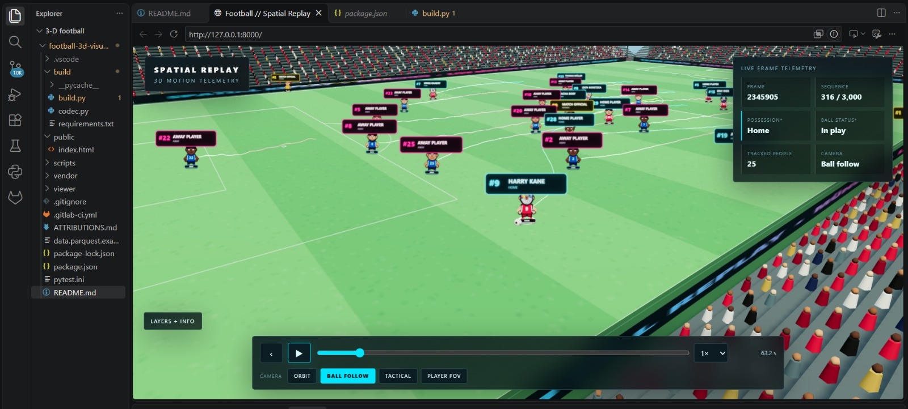

# 3D Football Visualizer

**Interactive Football Tracking Visualization | AWS Kiro Workshop Project**

An interactive, offline-first 3D football visualization built using JavaScript, Three.js, HTML, CSS, and Python.

I started this project during an **AWS Kiro workshop**, where I explored AI-assisted software development and **spec-driven development**. This approach focuses on defining requirements, designing a solution, and breaking implementation into manageable tasks before writing code.

The application visualizes approximately 3,000 frames of football tracking data, showing player movement and ball tracking in an interactive 3D stadium.

## Key Features

- Interactive 3D football replay with animated players and ball movement
- Multiple camera perspectives
- Stadium environment with lighting and an instanced audience
- Player representations with embedded portraits
- Motion trails and customizable visualization layers
- Offline-first operation without an API, database, or backend server
- Standalone static HTML application

## Technologies Used

| Technology | Purpose |
|---|---|
| JavaScript | Application logic and interaction |
| Three.js / WebGL | 3D rendering and animation |
| HTML & CSS | User interface |
| Python | Tracking-data processing and build automation |
| Git & GitLab | Version control and hosting |
| AWS Kiro | AI-assisted and spec-driven development |

## Project Preview

### 3D Stadium Visualization



### Football Tracking Replay



## What I Learned

This project helped me explore how tracking data can be transformed into an interactive 3D visualization.

During the AWS Kiro workshop, I learned how AI-assisted development can support a structured workflow:

**Requirements → Design → Implementation Tasks**

I also gained practical exposure to Three.js, browser-based rendering, Python data processing, and organizing a software project across multiple files.

## Run Locally

The ready-to-use application is located at `public/index.html`.

### Windows

Open a terminal in the project directory and run:

```powershell
py -m http.server 8000 --directory public
```

### macOS / Linux

```bash
python3 -m http.server 8000 --directory public
```

Then open:

http://127.0.0.1:8000

You can also open `public/index.html` directly in a modern browser. A local server provides more consistent browser behavior.

## Project Structure

| File / Directory | Description |
|---|---|
| `public/index.html` | Standalone application |
| `viewer/app.js` | Stadium, players, cameras, lighting, and interface |
| `viewer/core.js` | Playback, decoding, and tracking logic |
| `viewer/template.html` | HTML and CSS template |
| `viewer/roster.json` | Player, jersey, and portrait mappings |
| `viewer/portraits/` | Local portrait assets |
| `build/codec.py` | Tracking-data encoder |
| `build/build.py` | Single-file application builder |
| `.gitlab-ci.yml` | GitLab CI/CD configuration |
| `screenshots/` | Project screenshots |

## Deployment

The repository includes a `.gitlab-ci.yml` configuration for deploying the application as a static website through GitLab Pages.

If GitLab Pages is enabled for the project and the pipeline succeeds, the deployment URL can be found under **Deploy → Pages**.

The application does not require a separate backend server, database, or runtime API.

## Rebuild with Tracking Data

The ready-to-use application in `public/` does not require rebuilding.

To regenerate it from the original tracking data:

1. Place the private HTML redirect stub at `data.parquest` in the project root. This file must not be committed to Git.

2. Create a Python virtual environment:

```bash
python3 -m venv .venv
```

3. Install the required dependencies:

```bash
.venv/bin/pip install --only-binary=:all: -r build/requirements.txt
```

4. Run the builder:

```bash
.venv/bin/python build/build.py --stub data.parquest --out public/index.html
```

On Windows, use `.venv\Scripts\python.exe` instead of `.venv/bin/python`.

The builder downloads the Parquet file into a temporary directory, verifies it, embeds the compressed tracking data and local assets, and removes temporary files.

## Data Limitations

The original tracking dataset identifies teams as `Home` and `Away` and provides jersey numbers without verified team identities.

The visualization currently assumes that `Home` represents FC Bayern. This assumption is disclosed in the application, and uncertain player mappings remain generic.

## Security

The private file `data.parquest` contains a temporary signed download URL and must never be uploaded to a public repository.

The repository excludes the original tracking dataset, virtual environments, caches, and other unnecessary development files.

## Browser Compatibility

Use a modern desktop browser such as Chrome, Edge, Firefox, or Safari with WebGL and `DecompressionStream` support.

For better performance on slower devices, disable the **Audience** visualization layer.

## Credits and Attribution

Third-party libraries, player portraits, and other assets are documented in [ATTRIBUTIONS.md](ATTRIBUTIONS.md).

This project was developed as a learning experience following an AWS Kiro workshop, with a focus on software development, interactive data visualization, and AI-assisted development workflows.
